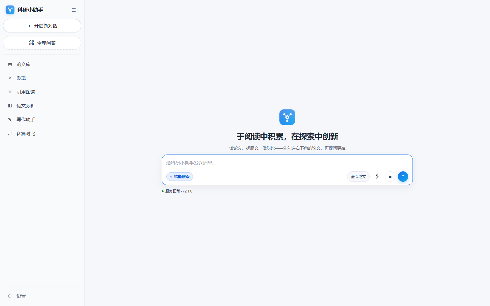
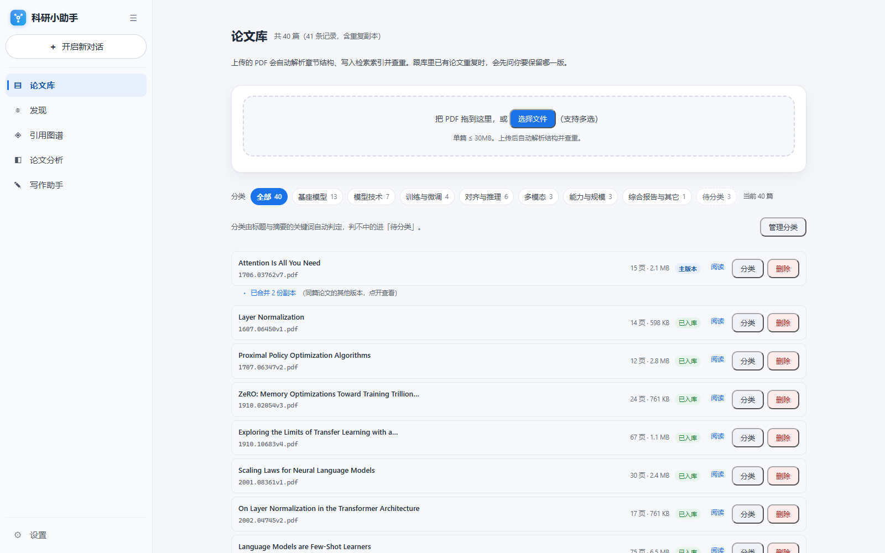
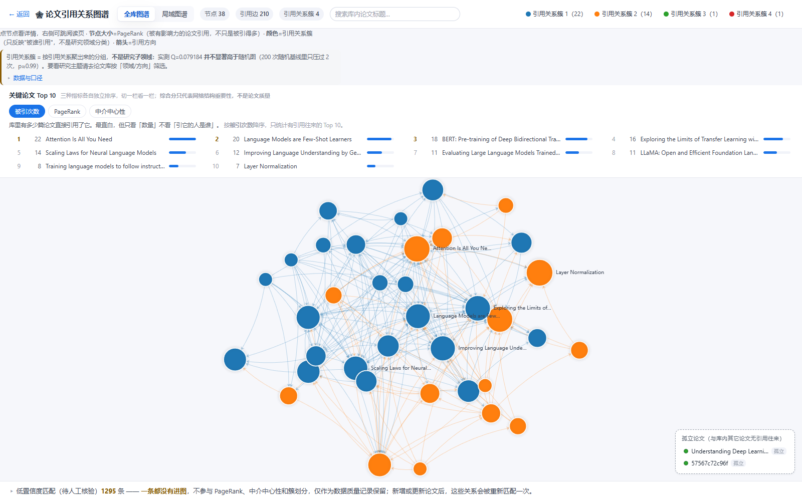
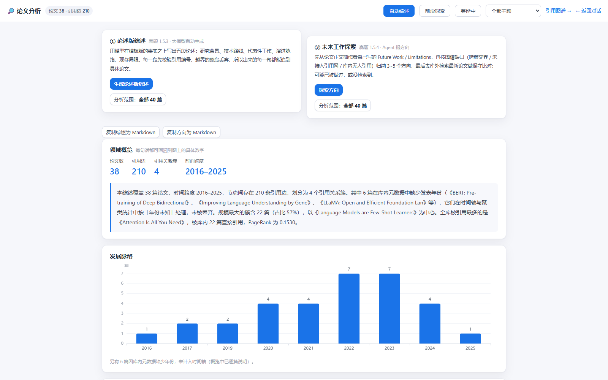
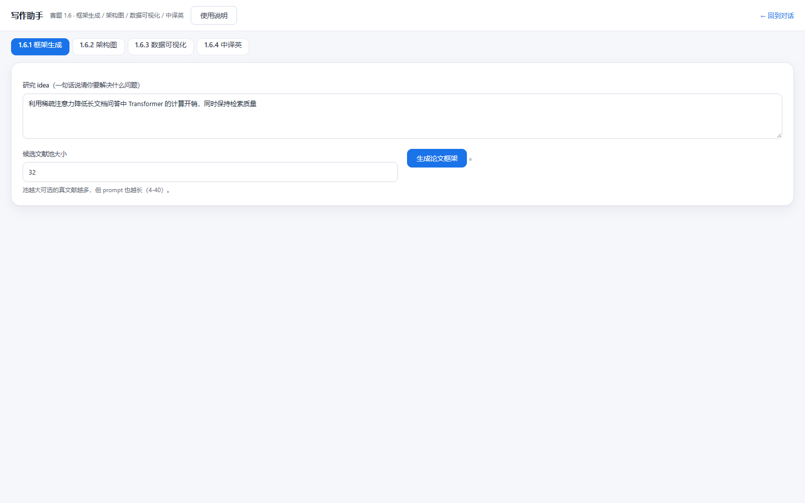
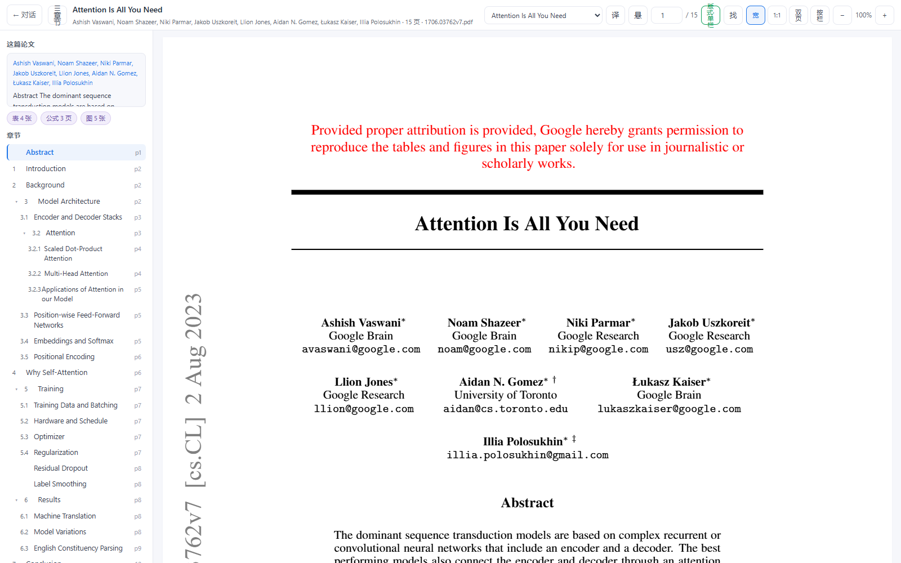
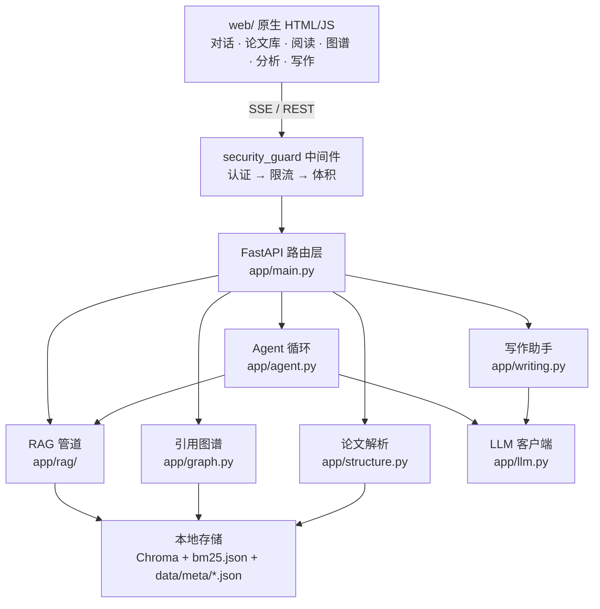
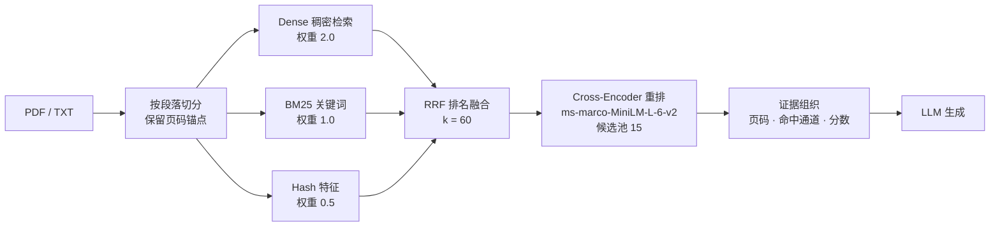
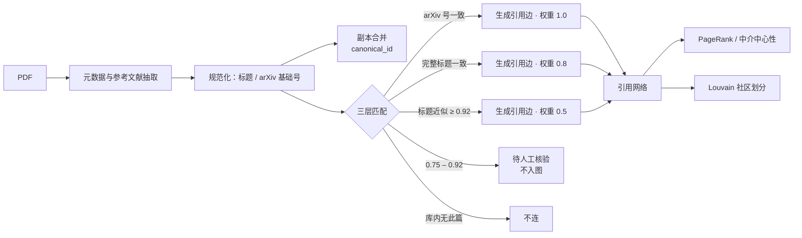
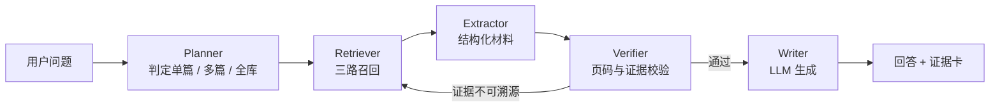

# 科研小助手 · Research Agent

> 一个**以证据为中心**的科研论文分析与写作辅助系统：混合检索 RAG 负责"找到真正相关的原文"，引用关系图谱负责"看清论文之间谁引了谁"，多阶段流水线把检索结果组织成可逐句回溯的综述与写作产物。


**在线实例**：<https://research-agent.top/ui/>　（公开演示页无需登录；配置中心与论文删除需管理员口令）

---

## 目录

- [它解决什么问题](#它解决什么问题)
- [核心亮点](#核心亮点)
- [界面](#界面)
- [核心功能](#核心功能)
- [系统架构](#系统架构)
- [RAG 混合检索](#rag-混合检索)
- [引用关系图谱](#引用关系图谱)
- [Agent 多阶段流水线](#agent-多阶段流水线)
- [科研写作辅助](#科研写作辅助)
- [技术栈与模块](#技术栈与模块)
- [项目目录](#项目目录)
- [本地部署](#本地部署)
- [测试与工程质量](#测试与工程质量)
- [安全设计](#安全设计)
- [能力边界与已知限制](#能力边界与已知限制)
- [后续规划](#后续规划)
- [License 与致谢](#license-与致谢)

---

## 它解决什么问题

读一篇论文时，真正费时间的往往不是读，而是这些事：这个公式在第几页、那张架构图出自哪篇、这个说法原文到底怎么写的、这十篇之间谁引了谁、写综述时哪些文献是真实存在的。

大模型能代劳其中大部分，但学术场景对错误零容忍——一条编造的参考文献足以毁掉一份工作。因此本项目的三个核心取舍是：

1. **答案必须能指回原文**：每条结论标注来源文件与页码，检索不到就不生成，而不是生成一段"看起来像"的话。
2. **引用必须在结构上不可伪造**：模型只能写候选编号，参考文献条目由代码从真实元数据组装。
3. **低置信度不硬连**：引用图谱中相似度落在待核验区间的条目不生成边，宁可少连不可错连。

面向对象：需要在一个私有论文库上做精读、跨篇对比、文献综述与投稿写作的学生与研究者。

---

## 核心亮点

| 亮点 | 解决的问题 | 代码位置 |
|---|---|---|
| **三路召回 + RRF + 交叉编码器重排** | 单一向量检索对术语、编号、公式类查询召回不稳 | [`app/rag/pipeline.py`](app/rag/pipeline.py) · [`app/rag/rerank.py`](app/rag/rerank.py) |
| **候选池约束生成** | 模型编造参考文献；事后校验拦不住格式正确的假引用 | [`app/writing.py`](app/writing.py) |
| **引用图谱：副本合并 + 三层匹配 + 低置信度不入图** | 同一论文多版本会拆成多个节点，令 PageRank 失真；错边会污染整张图 | [`app/graph.py`](app/graph.py) |
| **Validity 回环：Verifier 驱动 Retriever 重检** | 证据无页码时不再"标红就结束"，而是换信号再检一次 | [`app/agent.py`](app/agent.py) |

两个刻意没有做的选择，同样重要：

- **没有让多个 LLM Agent 互相对话**。问答链路已在秒级到十几秒量级，多角色互聊会放大到分钟级；四个阶段本就是确定性程序，包装成"自主智能体"没有技术收益（详见 [Agent 多阶段流水线](#agent-多阶段流水线)）。
- **没有把图谱结构指标解释成论文质量**。PageRank 反映的是引用网络中的结构重要性；Louvain 社区只是引用关系簇，本项目还对其做了显著性检验并如实报告"不显著"（详见 [引用关系图谱](#引用关系图谱)）。

---

## 界面

> 截图取自线上实例（`https://research-agent.top`，2026-11-18，1600×1000）。

**对话首页**：左侧栏统一入口，中间是输入坞，回答按「结论 → 依据 → 局限 → 下一步」四段呈现。



**论文库**：上传即解析章节、表格、图、公式与参考文献，内容级查重与版本合并。



**引用关系图谱**：副本合并为逻辑节点后的引用网络，节点大小表示 PageRank，颜色表示引用关系簇。



**论文分析**：论述版综述与未来工作探索，每段先校验后下发。



**写作助手**：论文框架、架构图、数据可视化、中译英四个子功能。



**阅读页**：章节树、页码定位、引用双向跳转、划词翻译。



---

## 核心功能

| 模块 | 能力 | 页面 |
|---|---|---|
| 论文库 | PDF 上传、内容级去重（同篇不同版本自动识别）、章节树 / 表格 / 图 / 公式 / 参考文献解析 | 论文库 |
| 检索问答 | 单篇、多篇与全库问答，逐句带来源与页码，检索不到即拒答 | 对话 |
| 阅读器 | 章节树、引用双向跳转、版式识别、划词翻译、悬停翻译、整篇翻译、中英对照 | 阅读页 |
| 文献发现 | arXiv / GitHub 检索、参考文献反查、新论文推荐与反馈调优 | 发现 |
| 引用图谱 | 副本合并、三层引用匹配、PageRank / 中介中心性、引用关系簇、局域图谱 | 引用图谱 |
| 论文分析 | 论述版综述（五段、逐段校验）、未来工作探索（三路缺口 + 库外比对） | 论文分析 |
| 写作助手 | 框架生成（候选池约束）、架构图渲染、CSV 数据可视化、中译英 | 写作助手 |
| 多篇对比 | 官方四题固定列对比、常驻对话、逐字来源 | 多篇对比 |
| 设置中心 | 模型与检索参数在线热更新、密钥脱敏、知识库健康检查 | 设置中心 |

---

## 系统架构



**存储形态**：不引入关系型数据库。论文 PDF 存于 `data/papers/`；解析结果、目录、图谱、推荐结果均为 `data/meta/` 下的 JSON；向量检索使用 Chroma（`data/chroma/`），同时维护 `bm25.json` 与 `idf.json` 支撑关键词通道。单机部署、数据量可控，是这一取舍的前提。

---

## RAG 混合检索

### 链路



### 为什么不是单一向量检索

| 通道 | 擅长 | 单用时的失效场景 |
|---|---|---|
| Dense（稠密向量） | 语义相近、换种说法也能召回 | 精确编号、模型名、公式符号容易被语义"抹平" |
| BM25（关键词） | 术语、编号、专有名词精确命中 | 换说法、近义词、跨语言表述召回不到 |
| Hash（轻量特征） | 极低成本兜底 | 只有词形重合才命中 |

三路同时存在，是因为它们的失效场景并不重叠。稠密通道给语义、BM25 给精确匹配、Hash 在模型不可用时兜底。

关键实现细节（`app/rag/pipeline.py`）：

- **RRF 而不是分数加和**：三路的分数量纲不同（余弦相似度、BM25 分、哈希重合度），直接加和会让量纲大的通道主宰结果。RRF 只用名次：`weight / (k + rank + 1)`，`k = 60`。
- **召回深度 50，重排候选池 15**：召回太浅会把"排第 15 的正确块"直接漏掉，重排再准也救不回来；重排太深则成本失控。池大小在 38 题集上比较过 10 / 15 / 20，差异在噪声内，取 15 是"质量不吃亏、候选少 1/4"的折中。
- **参考文献片段降权**：形如 `Author et al. Title. arXiv:2312.14925` 的片段是"某论文引用过它"，不是正文；命中 ≥2 个引用格式特征时按 0.6 降权，但不硬删，保留可追溯。
- **稠密不可用时自动接管**：嵌入模型加载失败时由 Hash 通道以 2.0 权重接管，服务降级而不是报错。

### 证据如何组织

检索结果不是直接拼进 prompt，而是先组织成证据对象，逐条携带：来源文件名、页码、融合分、命中通道、原文片段。证据条数不足或页码缺失时，触发校验回环（见下节）。

---

## 引用关系图谱

### 从文件到网络



### 三个设计判断

**① 副本合并成逻辑节点，但不删文件。** 本地库同一篇论文常有多个版本，直接按文件建图会把它拆成多个节点、被引数随之分裂。按「规范化标题 ∪ arXiv 基础号 ∪ 元数据交叉核验」合并为 `canonical_id`，`copies` 保留全部文件名与访问链接。图中节点数少于文件数是设计结果，不是丢数据。

**② 三层匹配，低置信度不出边。** 相似度落在 `[0.75, 0.92)` 的匹配只计入「待人工核验」列表，不生成边。错一条边会让整张图的 PageRank 失真，宁可少连。

归一化过程中踩过并写进注释的坑：

- 不能把标题里空格全删（`A Survey of X` 会归一成 `asurveyof…`，与 `surveyof…` 撞键）；
- 自引必须先显式跳过，否则精确命中自身被静默丢弃后会落入模糊层，**凭空造出一条边**；
- 精确匹配必须同时比较词袋，只比归一化字符串会误连。

**③ 结构重要性 ≠ 论文质量。** 界面原文写的是「综合分只代表网络结构重要性，不是论文质量」。

### Louvain 结果做过显著性检验，结论是"不显著"

社区划分后的引用关系簇，用随机图做对照检验（`app/graph.py`，200 次随机重连）：

| 指标 | 实测值 |
|---|---|
| 模块度 Q | 0.079184 |
| 随机图 Q 均值 | 0.132 |
| 随机图 Q 的 95 分位 | 0.173 |
| 200 次随机图中被超过的次数 | 2 |
| p 值 | ≈ 0.99 |

真实网络只压过 2/200 的随机图，说明**社区结构不显著**。因此界面上这一项的名称是「引用关系簇」而不是「研究主题分类」——它描述的是引用密度聚集，不是经过语义验证的领域划分。这条检验结果在页面上直接展示，没有隐藏。

### 演示实例数据

| 指标 | 值 |
|---|---|
| 逻辑节点 | 38 |
| 引用边 | 210 |
| 引用关系簇 | 4 |
| 被引论文 / 引用论文 | 31 / 34 |
| 孤立节点 | 2 |
| 待人工核验条目 | 1295（其中标题近似 23） |
| 时间跨度 | 2016 – 2025 |

---

## Agent 多阶段流水线

### 五个阶段，只有最后一步调用 LLM



| 阶段 | 职责 | 是否调用 LLM | 产物 |
|---|---|---|---|
| Planner | 判定问句是单篇聚焦、多篇对比还是全库检索，生成检索词 | 否 | 检索计划 |
| Retriever | 三路召回、融合、重排、去重折叠 | 否 | 召回片段、覆盖论文数 |
| Extractor | 从片段中加工结构化材料（卡片 / 表格行 / 正文段） | 否 | 材料条数 |
| Verifier | 校验证据是否有页码、能否定位到具体论文 | 否 | 证据条数、可定位条数 |
| Writer | 基于证据与结构化材料组织回答 | **是**（唯一一次生成调用） | 答案正文 |

每个阶段携带 `duration_ms` 与 `ok`，前端渲染为角色时间线；失败标红。顶部状态回显形如 `证据=4 · 覆盖论文=2 · 页码=2,11`。

### 校验回环

Verifier 判定证据不可溯源时，不再只打个红点，而是驱动 Retriever 按成本从低到高重检，命中即止（`app/agent.py` 的 `_repair_unverifiable()`）：

| 顺序 | 策略 | 动作 | 代价 |
|---|---|---|---|
| 1 | `page_fill` | 按来源取该论文第一页正文，确认片段确实在第 1 页才标页码 | 零（读本地缓存） |
| 2 | `rerank` | 更换排序路径（RRF 名次 ↔ 交叉编码器打分） | 极低（复用已加载模型） |
| 3 | `widen` | `top_k` 翻倍重新检索 | 数秒 |

三条全部失败时如实上报，时间线保留 `ok=False` 并注明「试过 page_fill / rerank / widen 仍未补回」，不静默降级。补页码的标准同样保守：只有第一页正文确实包含该片段前 60 字才标注。

### 边界说明

- 当前库的检索结果正常路径下均带页码，该回环是防御性设计，触发条件与三条策略由 `tests/test_rag_agent.py` 覆盖。
- 阶段之间**没有**让模型互相对话，也没有让模型自主决定调用哪个工具之外的流程；Plan 到 Write 的顺序是代码写死的。
- Agent 侧的上游流关闭在 2026-11-18 修复：用户在流式过程中点停止时，`AsyncStream` 的内部 `finally` 不会执行，底层连接只能等 GC——现在用 `try/finally` 覆盖正常读完、用户取消、上游异常、工具调用四条路径（`app/agent.py` 的 `_close_agent_stream()`）。

---

## 科研写作辅助

### 候选池约束生成：让模型在结构上无法编造引用

让大模型写综述框架，它会凭空捏造参考文献；事后用正则或相似度校验拦不住——模型可以编出格式完全正确、DOI 与 arXiv 号一应俱全的假条目。

做法（`app/writing.py`）：

1. 先用研究主题走真实检索（本地库 + arXiv + Crossref），得到候选池，编号 `C1..Cn`；
2. 候选池连同编号写入 prompt，要求模型**只能引用池内的 key**，只产出 `[C3]` 这类标记；
3. **参考文献列表由代码从候选池组装**，`format_reference` 是唯一能产生条目的函数，模型无法接触到它；
4. 生成后由 `check_citations` 校验悬空 key（`unknown_keys`），并回报未被使用的候选；
5. 候选池为空时**不硬生成**，直接返回「没有检索到任何真实文献，为避免编造引用，未生成框架」。

这套约束的意义在于：模型的输出空间里根本不含"写一条完整文献条目"这个动作。防伪造靠的是生成结构，不是提示词。

### 四个子功能

| 子功能 | 实现 | 状态 |
|---|---|---|
| 框架生成 | 候选池约束 + 悬空引用校验 | 可用 |
| 架构图 | Mermaid / Graphviz 渲染，失败回喂错误修正语法，重试一次 | 可用 |
| 数据可视化 | CSV → ECharts / matplotlib；类别列 + 多数值列自动出分组柱或折线 | 可用 |
| 中译英 | `app/zh2en.py`，面向投稿的学术语域约束 | 可用 |
| TikZ 渲染 | 依赖服务器字体映射，当前环境不可用 | **不可用，界面如实报错** |

架构图另有一路反向能力（`GET /writing/paper-figures`）：按论文名与关键词从**库内 PDF 中定位已有的架构图**，连同页码一并返回。被问到"这张图哪来的"时可直接指回原文第几页。

---

## 技术栈与模块

| 层 | 选型 | 说明 |
|---|---|---|
| Web 框架 | FastAPI + uvicorn | SSE 流式输出走 sse-starlette |
| 前端 | 原生 HTML / JS，无构建步骤 | 10 个 HTML 页面 + 1 套设计系统变量，部署即用 |
| LLM 接入 | OpenAI 兼容协议（`app/llm.py`） | 不锁定厂商，可指向本地 Ollama / vLLM |
| 向量库 | Chroma | 数据 < 10 万条、单机部署 |
| 检索 | 自研三路召回 + RRF + 交叉编码器 | `app/rag/` |
| PDF 解析 | PyMuPDF / pypdf + RapidOCR | 文本型优先，扫描件走 OCR |
| 图计算 | networkx | PageRank / 中介中心性 / Louvain |
| 图表 | ECharts + matplotlib | 网页预览与 PNG 导出 |
| 存储 | JSON 文件 | 不引入数据库 |

**核心自研模块**：

| 模块 | 文件 | 职责 |
|---|---|---|
| Agent 循环 | `app/agent.py` | 五阶段流水线、校验回环、上游流关闭 |
| RAG 管道 | `app/rag/pipeline.py`、`rerank.py` | 三路召回、RRF、交叉编码器重排 |
| 论文解析 | `app/structure.py` | 章节 / 表格 / 图 / 公式 / 参考文献 |
| 引用图谱 | `app/graph.py` | 副本合并、三层匹配、PageRank、引用关系簇、综述、前沿探索 |
| 论述版综述 | `app/narrative.py` | 五段生成 + 逐段代码校验后才下发 |
| 未来工作探索 | `app/future_work.py` | 作者自述抽取 + 图谱缺口 + 库外比对 |
| 写作助手 | `app/writing.py`、`diagram.py`、`chart.py`、`zh2en.py` | 候选池约束、渲染器、图表、中译英 |
| 安全中间件 | `app/security.py` | 路由归类、令牌桶限流、每日预算 |

---

## 项目目录

```
campus-agent/
├── app/                      # 后端（35 个顶层模块 + rag/ tools/ 子包）
│   ├── main.py               # FastAPI 入口、路由层、security_guard 中间件
│   ├── agent.py              # Agent 五阶段流水线 + 校验回环
│   ├── rag/                  # 三路召回 + RRF + 交叉编码器重排
│   ├── structure.py          # 章节 / 表格 / 图 / 公式 / 参考文献解析
│   ├── graph.py              # 引用图谱与论文分析
│   ├── narrative.py          # 论述版综述：五段生成 + 逐段校验
│   ├── future_work.py        # 未来工作探索
│   ├── writing.py            # 写作助手：候选池约束生成
│   ├── diagram.py / chart.py # 架构图 / 数据可视化
│   ├── zh2en.py / translate.py  # 中译英（投稿向）/ 英译中（阅读向）
│   ├── papers.py             # 论文库：上传、查重、版本合并
│   ├── security.py           # 路由对账、限流、预算
│   └── settings_api.py       # 配置热更新
├── web/                      # 前端（原生 HTML/JS，无构建）
│   ├── index.html            # 对话
│   ├── library.html          # 论文库
│   ├── reader.html           # 阅读页
│   ├── graph.html            # 引用图谱
│   ├── analysis.html         # 论文分析
│   ├── writing.html          # 写作助手
│   ├── compare.html          # 多篇对比
│   ├── settings.html         # 设置中心
│   ├── design-system.css     # 设计系统变量
│   └── vendor/               # pdf.js、ECharts（本地化，不依赖 CDN）
├── tests/                    # 59 个测试文件，不联网、不消耗 API 额度
├── scripts/                  # 解析、索引、评测、打包脚本
├── docs/                     # 交接文档、审查记录、答辩材料、截图
├── data/                     # 论文、解析结果、索引（不进 git）
├── requirements.txt
├── .env.example
└── pyproject.toml
```

---

## 本地部署

```bash
# 1. 安装依赖
pip install -r requirements.txt

# 2. 准备配置
copy .env.example .env
#    编辑 .env，填入 LLM_API_KEY

# 3. 跑测试（不联网、不消耗 API 额度）
pytest tests -q

# 4. 启动
python -m app.main
#    页面    http://127.0.0.1:8000/ui/
#    接口文档 http://127.0.0.1:8000/docs（APP_ENV=prod 时关闭）
```

### 模型接入

大模型接入层走标准 OpenAI 兼容协议，不锁定单一厂商。任何兼容接口都可以使用，手填 `LLM_BASE_URL` 与模型名即可；设置中心内置七家厂商预设，选中后写入 `LLM_BASE_URL` / `LLM_MODEL` / `LLM_API_KEY` 三项并立即生效，无需重启。

API Key 的三条约定：

- **只存本地**：Key 写在 `.env`，不进 git；
- **读不回来**：`GET /settings` 只返回掩码（`sk-****abcd`），前端拿不到明文；
- **改不坏**：切换厂商时三项一次写入，中途失败整体回滚。

### 管理员配置

公开演示与管理保护需要同时成立。`ADMIN_TOKEN` 与 `ADMIN_COOKIE_SECRET` 必须同时配置，缺一即管理接口返回 503（并非放行）。会话 Cookie 为 `HttpOnly` + `SameSite=Strict`，生产环境附加 `Secure`，有效期 2 小时。

---

## 测试与工程质量

所有数字均来自本仓库当前状态，附复现命令。

| 项 | 数据 | 复现方式 |
|---|---|---|
| 自动化测试 | **979 passed, 1 skipped**（114.02s） | `pytest tests -q` |
| 静态检查 | **All checks passed** | `ruff check .` |
| 代码规模 | `app/` 26126 · `web/` 15559 · `tests/` 15191 · `scripts/` 5380，合计 **62256 行** | `python scripts/count_lines.py` |
| 文件分布 | `app/` 42 个 py（含子包）；`web/` 10 个 html + 6 个 js/css；`tests/` 59 个 py；`scripts/` 35 个 py | 同上 |
| 路由安全对账 | 管理 15 条 · 公开 47 条 · 按方法区分 1 条 | `app/security.py` 的 `ADMIN_PATHS` / `PUBLIC_PATHS` / `METHOD_ADMIN_PATHS` |
| 解析产物（本地 46 条记录） | 章节 2314 · 表格 560 · 图 569 · 公式 3438 · 参考文献 184 | `data/meta/structures.json` |
| 演示实例 | 论文 40 篇（41 条记录）；图谱 38 节点 / 210 边；引用关系簇 4 | `GET /papers`、`GET /graph` |
| 前端设计系统 | 181 个 CSS 变量统一定义色板、间距、字号与角色色，ECharts 直接读取变量 | `web/design-system.css` |

测试口径说明：测试全部离线运行，LLM 调用、嵌入模型与网络请求均被替换为桩件；因此测试覆盖的是**业务逻辑与约束**（检索融合、引用校验、图谱匹配、错误回滚），不是生成质量。生成质量没有量化指标，本项目也不宣称任何准确率或幻觉率。

修复过程可追溯：2026-11-18 一轮修复新增了 17 条测试（上游流关闭 12 条 + 结构总表回滚 5 条），并修复了 PDF 上传失败后 `structures.json` 残留幽灵记录的问题——失败时回滚整份旧表，而不只是删掉自己的键。

---

## 安全设计

**启动即对账的路由安全模型**：启动时遍历全部路由，逐条归类为「管理」或「公开」。任何一条路由既不在管理组也不在公开组，**服务直接拒绝启动**。新增接口时忘记加鉴权是此类漏洞的首要来源，把"人可能忘"的事变成"机器必须过"的关。

**中间件顺序有实际后果**：认证 → 限流 → 体积。先认证让未授权请求尽早被拒，不必为它做限流记账；先限流再校验体积，避免攻击者用超大请求体消耗解析开销。

**未登记路径返回 404 而非 401**：401 等于告知对方"这里确实有接口"。

**资源限额**：按 IP 令牌桶限流、登录失败锁定（15 分钟）、每日调用次数闸（`LLM_DAILY_BUDGET=800`）、并发上限（`LLM_MAX_CONCURRENCY=4`）。请求体按类型分档，体积检查在接收流上边读边计，超限立即中断。

---

## 能力边界与已知限制

**未实现或不可用（如实标注）**

- **TikZ 架构图渲染**：依赖服务器字体映射，当前环境不可用；界面会如实报告，不会假装成功。
- **Docker**：`Dockerfile` 已提供但未在本机实跑验证。
- **论文分析页「英译中」标签、写作助手「三维雷达图」**：功能已实现但未做端到端实测。

**已量化的不足**

- 引用图谱有 **23 条标题近似匹配**待人工核验（相似度落在 0.75–0.92，未入图）；另有 1272 条条目的 arXiv 号库内没有、也找不到同标题论文，属正常缺口。
- 表格结构化解析存在无单元格的情况（本地 560 张表中有 137 张未抽出单元格），跨栏表格尤其容易失败。
- 作者-单位映射只覆盖部分论文（双栏版面下容易张冠李戴，代码宁可不匹配也不按列轮转硬配）。

**设计性限制**

- 对话历史只存浏览器 `localStorage`，服务端未持久化——换浏览器看不到历史。这是有意为之（不引入用户体系）。
- 限流状态与每日预算计数存于进程内存，服务重启即清空，多 worker 部署时不共享。
- 切分按段落而非语义，跨章节提问的召回仍有优化空间。
- 扫描件 PDF 依赖 OCR，速度比文本型 PDF 慢一个量级。

**明确不做**

- 深色模式。
- 让模型在原文没写的情况下对外部知识做补全式推断（例如推断论文未给出的参数量）——这与全系统的防幻觉定位冲突。

---

## 后续规划

按投入产出排序，不承诺时间：

1. **语义切分**替代段落切分，改善跨章节提问的召回。
2. **表格单元格回填**：针对 137 张未抽出单元格的表格，补版面与合并单元格处理。
3. **多 worker 下的限流与预算共享**：迁到 Redis 或文件锁，消除重启清空问题。
4. **TikZ 字体映射**：让服务器端可渲染中英文标注的 TikZ 图。
5. **图谱低置信度条目的批量复核工具**，把 23 条人工核验流程化。

---

## License 与致谢

本项目以 **MIT** 许可发布，见 [LICENSE](LICENSE)。

第三方依赖与许可：

| 库 | 用途 | 许可 |
|---|---|---|
| FastAPI / uvicorn | Web 接口与服务 | MIT / BSD-3-Clause |
| openai | LLM 客户端（兼容多厂商） | Apache-2.0 |
| chromadb | 向量存储 | Apache-2.0 |
| PyMuPDF / pypdf | PDF 解析 | AGPL-3.0 / BSD-3-Clause |
| pdf.js / ECharts | 前端渲染与图表（本地化 vendor） | Apache-2.0 |
| networkx | 图算法 | BSD-3-Clause |
| sentence-transformers | 交叉编码器重排 | Apache-2.0 |
| numpy / pandas / matplotlib | 数据处理与图表导出 | BSD-3-Clause |
| pytest / ruff | 测试与静态检查 | MIT |

交叉编码器权重来自 `cross-encoder/ms-marco-MiniLM-L-6-v2`，遵循其原始许可。若后续引入第三方开源项目代码，会在 `THIRD_PARTY.md` 中注明来源、修改点与遵循的协议。
